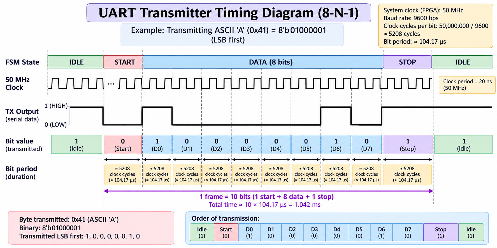
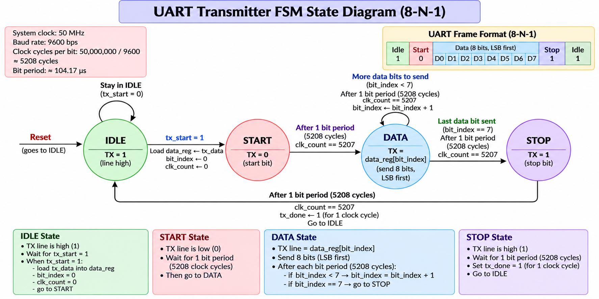
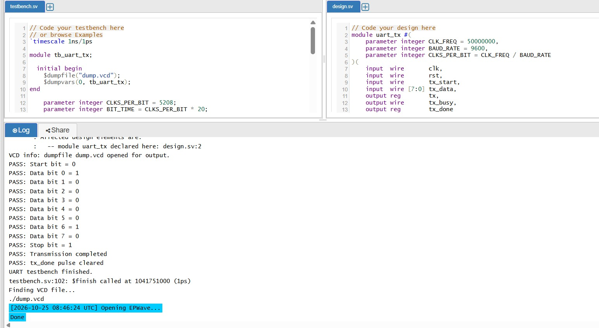
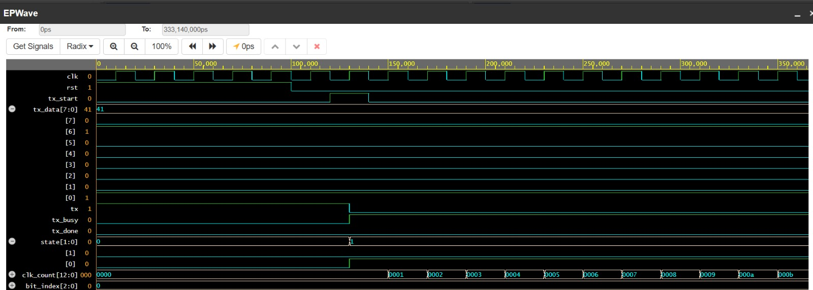

# UART Transmitter Design Using Verilog HDL

## Project Overview

This project implements a **UART (Universal Asynchronous Receiver-Transmitter) transmitter** using Verilog HDL. I started by learning the fundamentals of UART communication and digital design, then implemented the transmitter RTL, created a testbench, and verified its operation through simulation and waveform analysis.

The project helped me understand how a digital communication protocol is translated into hardware logic using Verilog.

## Learning Journey: From Scratch

### 1. Understanding UART Communication

I learned how UART transfers data serially, one bit at a time, between digital devices without a shared clock between the communicating endpoints.

I studied the **8-N-1 frame format**:

- **8 data bits:** One byte of information.
- **N — No parity:** No parity bit is transmitted.
- **1 stop bit:** Marks the end of a frame.
- **Idle state:** The TX line remains HIGH when no data is being transmitted.
- **Start bit:** The TX line goes LOW to indicate the beginning of transmission.
- **LSB first:** Data is transmitted from the least significant bit to the most significant bit.

### 2. UART Transmitter Timing Diagram

The timing diagram helped me understand the relationship between the FSM states, system clock, serial TX output, and individual data bits.

**What I learned:**
- How a complete UART frame consists of one start bit, eight data bits, and one stop bit.
- How ASCII character `A` is represented by `8'h41` and transmitted LSB-first.
- How the TX output changes between HIGH and LOW according to the bit being transmitted.
- How clock cycles determine the duration of each bit.
- How the system clock frequency and baud rate determine the number of clock cycles per bit.

**Example configuration:**
- System clock: 50 MHz
- Baud rate: 9600 bps
- Clock cycles per bit: 5208
- Approximate bit period: 104.17 µs
- Approximate 10-bit frame duration: 1.042 ms

### 3. Finite State Machine (FSM) Design

I learned how to divide a digital design into states and use state transitions to control the sequence of operations.

The transmitter uses four states:

- **IDLE:** Keeps TX HIGH and waits for `tx_start`. When a transmission is requested, the input byte is stored in a register.
- **START:** Drives TX LOW for one bit period to indicate the beginning of the frame.
- **DATA:** Transmits eight bits sequentially, using a bit index to select the current bit.
- **STOP:** Drives TX HIGH for one bit period, signals completion through `tx_done`, and returns to IDLE.

I also learned how state transitions depend on clock counting and the completion of each bit period.

### 4. Verilog HDL Concepts Learned

I implemented the transmitter using Verilog and learned the purpose of:

- Module declarations, input/output ports, and parameterization.
- Registers and wires.
- Combinational logic using `always @(*)`.
- Sequential logic using `always @(posedge clk or posedge rst)`.
- `case` statements for FSM implementation.
- Non-blocking assignments (`<=`) in sequential logic.
- Reset handling, state registers, and local parameters.
- Clock counters and bit-index counters.
- Control signals such as `tx_start`, `tx_busy`, and `tx_done`.

### 5. Testbench and Functional Verification

I created a Verilog testbench to simulate the transmitter without requiring physical hardware.

Through simulation, I learned how to:
- Generate a clock and apply reset.
- Provide input data and trigger transmission.
- Observe the TX output and transmitter status signals.
- Check the start bit, transmitted data bits, and stop bit.
- Observe the completion signal and inspect waveforms using EPWave.

The simulation completed successfully for the tested transmission of ASCII `A` (`8'h41`).

### 6. Key Takeaways

By building this project from scratch, I developed a foundational understanding of:

- UART serial communication and frame structure.
- FSM-based digital design.
- Combinational and sequential logic in Verilog.
- Clock-cycle counting and baud-rate timing.
- Testbench development and simulation-based verification.
- Waveform analysis and technical documentation.

## Tools Used

- **HDL:** Verilog
- **Simulation:** EDA Playground with Icarus Verilog
- **Waveform Viewer:** EPWave
- **Version Control:** Git and GitHub

## Project Objective

The objective of this project was to build a functional UART transmitter while strengthening my fundamentals in RTL design, FSMs, Verilog coding, and digital hardware verification.

### FSM Design and Signal Explanation

The UART transmitter uses a four-state finite state machine to control serial transmission.

See the [FSM and Signal Documentation](docs/fsm-and-signals.md) for the state diagram, state transitions, baud-rate calculations, and signal descriptions.
## Simulation Results

### UART Transmitter Waveform

The waveform illustrates the UART transmitter's TX signal, FSM state transitions, and data-bit progression during transmission.

### Testbench Simulation Output

The simulation output shows the testbench checks for the start bit, all eight data bits, stop bit, and transmission completion.

