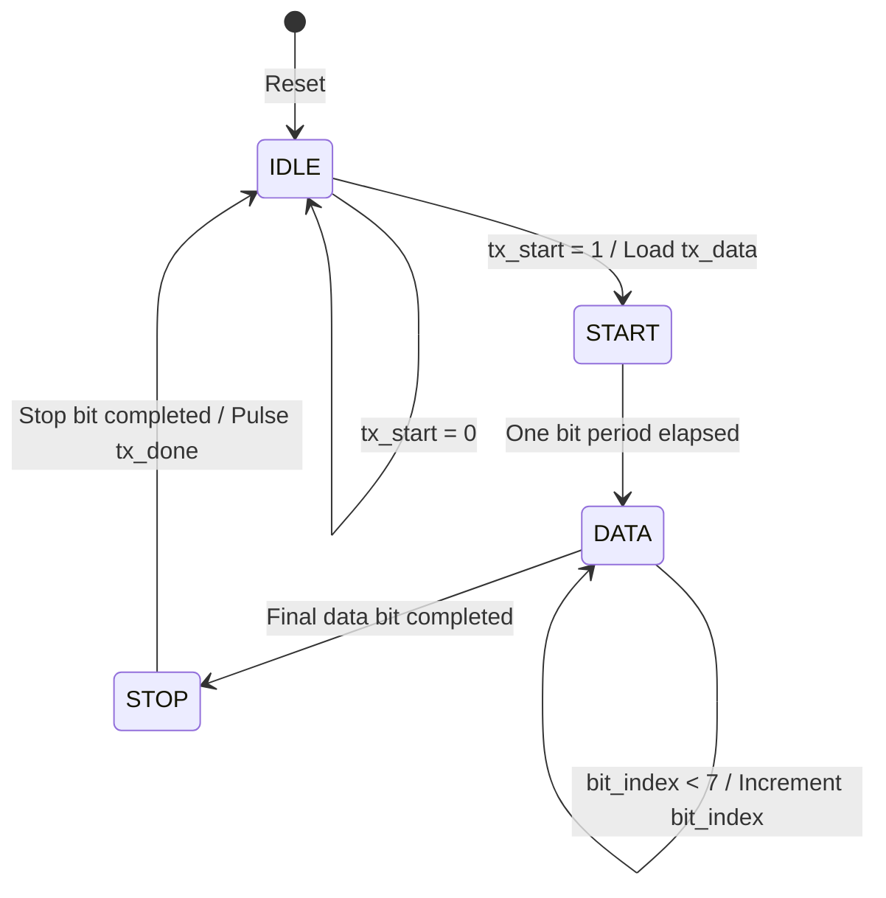

# UART Transmitter: FSM and Signal Explanation

## 1. Finite State Machine (FSM)

The UART transmitter uses four states to control the serial transmission of one byte.

- **IDLE:** TX remains HIGH while waiting for `tx_start`. When a request arrives, the input byte is stored in `data_reg`.
- **START:** TX becomes LOW for one bit period to indicate the beginning of a frame.
- **DATA:** The transmitter sends eight bits, starting from bit 0 (LSB first). `bit_index` selects the current bit.
- **STOP:** TX becomes HIGH for one bit period. The transmitter then pulses `tx_done` and returns to IDLE.

Reset returns the FSM to IDLE.

## 2. State Transition Diagram

## 3. UART Timing Calculations

- Clock frequency: 50 MHz
- Clock period: 20 ns
- Baud rate: 9600 bits per second
- Clock cycles per bit: floor(50,000,000 / 9600) = 5208
- Counter terminal count: 5207
- Actual bit period: 5208 × 20 ns = 104.16 µs
- Approximate 8-N-1 frame duration: 10 / 9600 ≈ 1.042 ms

## 4. Important Signals

| Signal | Purpose |
|---|---|
| `clk` | System clock |
| `rst` | Active-high asynchronous reset |
| `tx_start` | Requests transmission |
| `tx_data[7:0]` | Byte to transmit |
| `data_reg[7:0]` | Stores the byte during transmission |
| `clk_count[12:0]` | Counts clock cycles for each bit |
| `bit_index[2:0]` | Selects data bits 0 through 7 |
| `state[1:0]` | Stores the current FSM state |
| `tx` | Serial output |
| `tx_busy` | Indicates that transmission is active |
| `tx_done` | One-clock-cycle completion pulse |

## 5. Example: Transmitting ASCII A

ASCII A is hexadecimal `0x41`, or binary `01000001` in normal notation.

UART sends data least-significant bit first:

`Start 0 | D0 1 | D1 0 | D2 0 | D3 0 | D4 0 | D5 0 | D6 1 | D7 0 | Stop 1`

## 6. What I Learned

- UART serial communication and 8-N-1 framing
- Baud-rate and clock-divider calculations
- FSM states and transition logic
- Verilog sequential and combinational logic
- Testbench creation and waveform inspection using Icarus Verilog and EPWave
