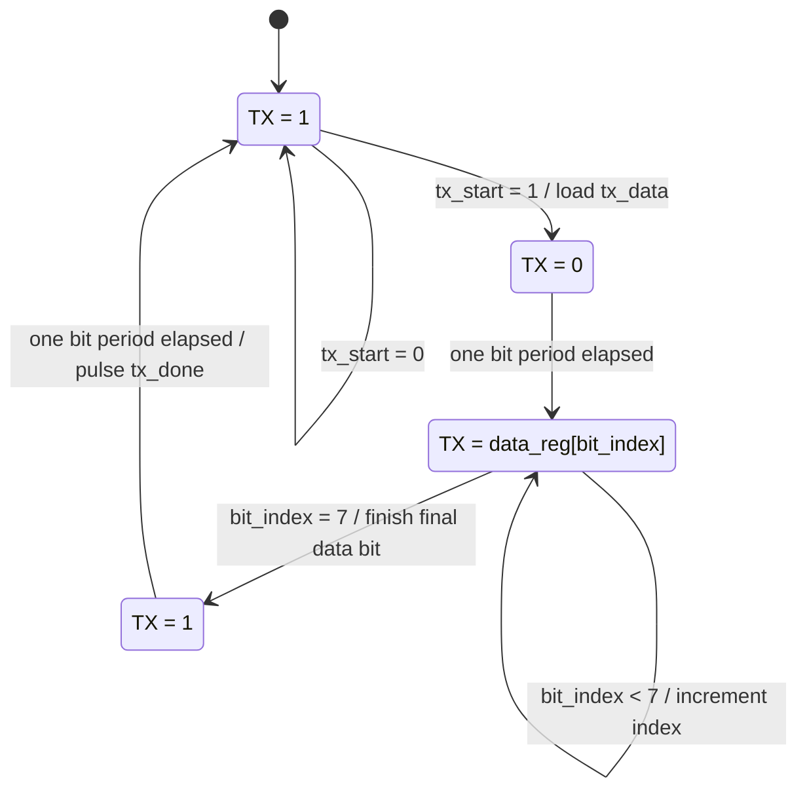

# FSM, Timing, and Signals

## UART transmitter FSM

Reset sends the FSM to `IDLE`. The state encoding in the RTL is `IDLE=00`, `START=01`, `DATA=10`, and `STOP=11`.

## How the data moves

1. `tx_start` is sampled while the FSM is idle.
2. `tx_data` is copied into `data_reg`, so the byte is held stable during the frame.
3. The state determines whether TX is idle-high, start-low, a selected data bit, or stop-high.
4. `clk_count` determines when one bit period has elapsed.
5. `bit_index` chooses `data_reg[0]`, then `[1]`, through `[7]`.
6. `tx_done` pulses when the stop period completes and the FSM returns to idle.

## Signals to add in EPWave

**Top-level signals**
- `clk`: fast periodic system clock
- `rst`: high during reset
- `tx_start`: short request pulse
- `tx_data[7:0]`: byte `0x41`
- `tx`: serial frame output
- `tx_busy`: high while a frame is in progress
- `tx_done`: one-clock pulse at completion

**Internal signals**
- `state[1:0]`: state encoding
- `clk_count[12:0]`: baud timing counter
- `bit_index[2:0]`: index of the data bit being sent
- `data_reg[7:0]`: stored byte

## What to look for in the waveform

- TX is high before a frame begins.
- START forces TX low for one bit period.
- DATA outputs `1,0,0,0,0,0,1,0` for ASCII `A`.
- STOP returns TX high.
- `tx_busy` drops when the FSM returns to IDLE.
- `tx_done` pulses high at completion.
